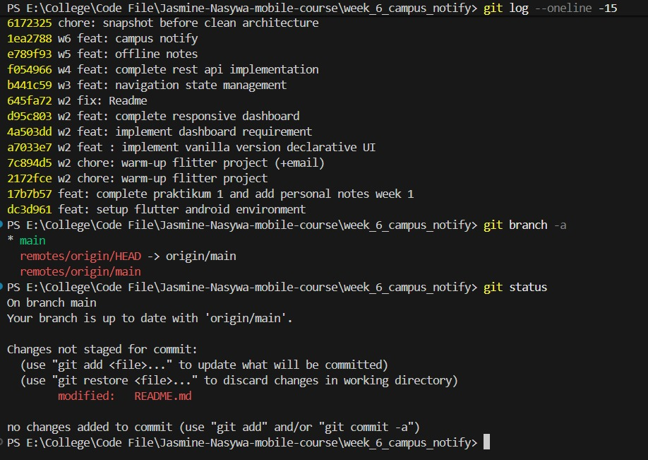
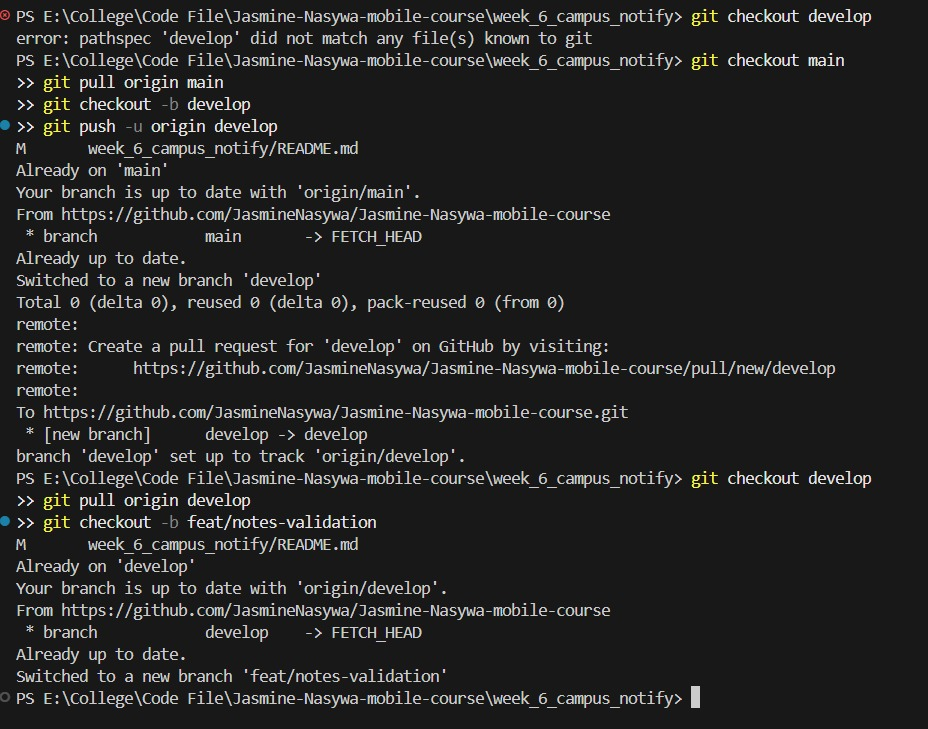
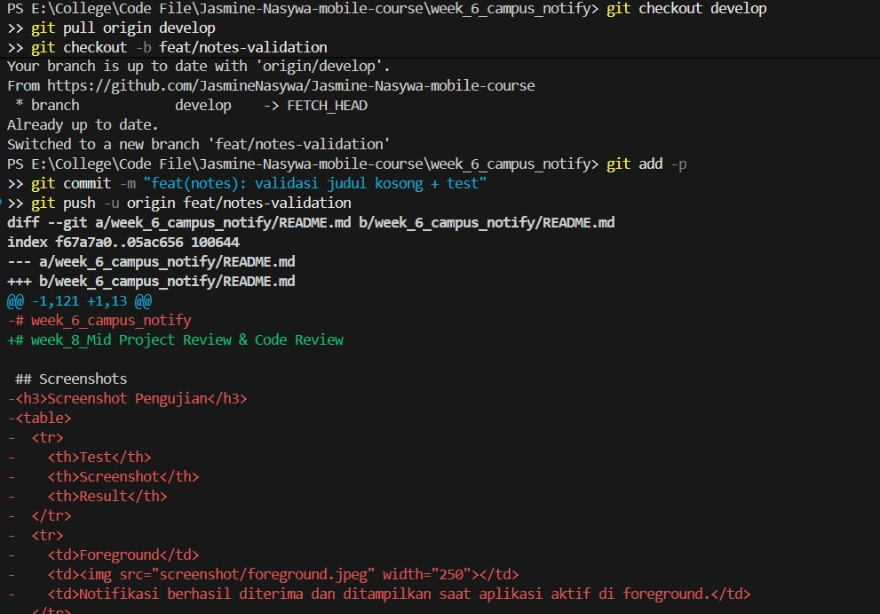
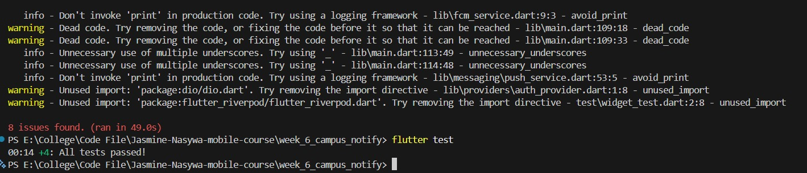

# week_8_Mid Project Review & Code Review

## Screenshots

<table>
  <tr>
    <td align="center"><strong>01</strong></td>
    <td align="center"><strong>02</strong></td>
  </tr>
  <tr>
    <td></td>
    <td></td>
  </tr>
  <tr>
    <td align="center"><strong>03</strong></td>
    <td align="center"><strong>04</strong></td>
  </tr>
  <tr>
    <td></td>
    <td></td>
  </tr>
</table>
 
## Refleksi

1. Apa beda LGTM buta dengan approve yang bertanggung jawab? Apa risikonya bagi tim?

LGTM buta adalah menyetujui Pull Request tanpa memeriksa kode dan hasil pengujiannya secara menyeluruh. Sementara itu, approve yang bertanggung jawab dilakukan setelah reviewer memahami perubahan, memeriksa kemungkinan kesalahan, dan memastikan pengujian yang relevan telah dilakukan. LGTM buta berisiko membuat bug lolos ke aplikasi, menurunkan kualitas kode, dan menambah beban perbaikan bagi anggota tim.

2. Kapan komentar wajib berstatus request changes, dan kapan cukup saran?

Request changes diperlukan ketika ditemukan masalah penting yang dapat menyebabkan bug, kesalahan logika, kegagalan pengujian, atau pelanggaran persyaratan fitur. Sementara itu, saran cukup diberikan untuk perbaikan yang tidak menghambat fungsi utama, seperti meningkatkan keterbacaan kode atau menyederhanakan implementasi. Dengan demikian, tim dapat memprioritaskan masalah yang benar-benar perlu diperbaiki sebelum Pull Request digabungkan.

3. Bagian mana dari review AI yang Anda tolak atau sederhanakan, dan mengapa?

Saran dari AI tidak langsung diterapkan seluruhnya. Setiap saran perlu diperiksa kembali kesesuaiannya dengan kebutuhan aplikasi, struktur kode, dan aturan yang digunakan dalam project. Saran yang terlalu kompleks atau tidak memberikan manfaat signifikan dapat disederhanakan agar implementasi tetap mudah dipahami dan dipelihara. AI digunakan sebagai alat bantu, sedangkan keputusan akhir tetap didasarkan pada kebutuhan dan hasil pengujian project.

4. Satu hal konkret yang Anda perbaiki setelah review sejawat, apa dampaknya?

Salah satu perbaikan konkret adalah menambahkan pemeriksaan otomatis melalui flutter analyze dan flutter test, serta merapikan format kode menggunakan dart format. Perbaikan ini membantu menemukan masalah kode lebih awal dan menjaga konsistensi format. Dengan pemeriksaan otomatis, proses review menjadi lebih efisien karena reviewer dapat lebih fokus pada logika, perilaku fitur, dan kualitas implementasi.

## Refactoring dan testing
gambar hasil testing berada di nomor 4 pada folder screenshoot

## AI Challenge

1. Lima temuan awal untuk AI review
P1
Test lama dihapus tanpa pengganti yang terlihat

File: test/widget_test.dart

Diff menunjukkan dua baris dihapus dan tidak ada penambahan pada file tersebut. Periksa apakah test lama memang sengaja dihapus dan apakah sudah ada test pengganti.

Verifikasi: jalankan flutter test. Kalau tidak ada test yang memeriksa routing atau halaman awal, tambahkan widget test yang relevan.

P2
File tema masih kosong

File: lib/core/theme/app_colors.dart, lib/core/theme/app_theme.dart

Keduanya ditambahkan tetapi belum berisi kode. Ini bukan bug runtime dengan sendirinya, tetapi bisa menjadi file placeholder yang belum diperlukan.

Usulan: isi saat implementasi tema dimulai, atau hapus sementara jika belum dipakai.

P2
Belum terlihat perpindahan dari splash ke home

File: lib/app/router.dart, lib/features/splash/splash_screen.dart

Router mendaftarkan /splash dan /home, dengan /splash sebagai lokasi awal. Splash saat ini hanya menampilkan teks.

Verifikasi: jika PR ini memang hanya menyiapkan placeholder, kondisi ini bisa diterima. Kalau persyaratannya adalah splash otomatis menuju home, navigasi tersebut belum terlihat pada diff.

Saran
Pemisahan App dan router sudah dimulai

File: lib/app/app.dart, lib/app/router.dart, lib/main.dart

App menggunakan MaterialApp.router, sedangkan konfigurasi GoRouter berada di file terpisah. Ini pemisahan tanggung jawab yang masuk akal untuk tahap awal.

Saran: pertahankan pemisahan tersebut dan hindari menaruh seluruh konfigurasi navigasi di main.dart.

Saran
Pemeriksaan otomatis belum terlihat

Halaman PR menunjukkan nol checks. Itu tidak membuktikan kode gagal, tetapi belum ada bukti CI berhasil dari tampilan tersebut.

Verifikasi: jalankan flutter analyze dan flutter test secara lokal, lalu siapkan workflow CI jika memang diwajibkan oleh praktikum.

Saran ditolak :
Saran untuk menghapus route /home ditolak karena route tersebut memang disiapkan sebagai tujuan navigasi berikutnya. Walaupun belum digunakan oleh splash screen pada tahap ini, pendaftaran route diperlukan untuk pengembangan fitur selanjutnya.

## Getting Started

This project is a starting point for a Flutter application.

A few resources to get you started if this is your first Flutter project:

- [Learn Flutter](https://docs.flutter.dev/get-started/learn-flutter)
- [Write your first Flutter app](https://docs.flutter.dev/get-started/codelab)
- [Flutter learning resources](https://docs.flutter.dev/reference/learning-resources)

For help getting started with Flutter development, view the
[online documentation](https://docs.flutter.dev/), which offers tutorials,
samples, guidance on mobile development, and a full API reference.
